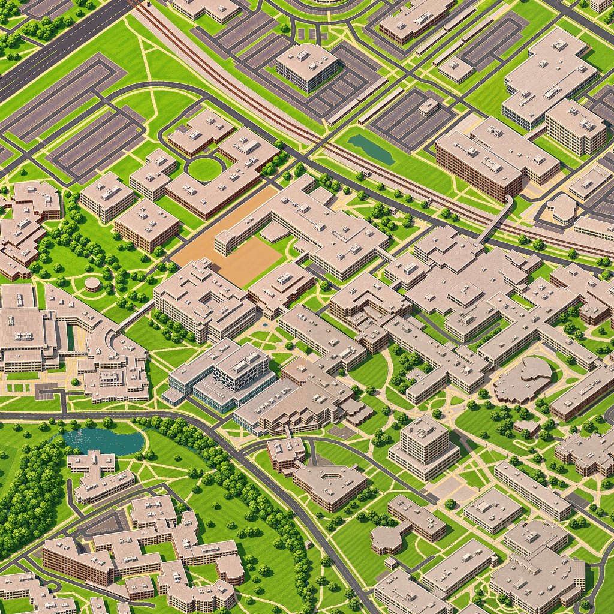

# Build status

Last updated 4 November 2026. Branch `claude/busy-turing-drkfqj`.

## Checkpoint 1: illustrated campus 2 × 2 is complete

| | |
|---|---|
| Illustrated (accepted generated art) | **All 55 tiles of the main area** (campus -> Waterloo Park -> Uptown -> Laurier, i -3..7, j -3..1). Two carry a known defect with a revision pending: 6_0 (ION LRT along King St S missing from y~720 down; B013R3) and 5_-3 (parking/apron invented on the Waterloo Fire Station #1 lawn; B017R1). Overview: `docs/review/art_progress.png` |
| Reference renders (procedural, awaiting art) | 0 tiles in the main area; the remaining 534 city tiles are not rendered yet |
| City coverage | Measured against the verified municipal boundary (OSM relation r2062154, 65.31 km², 589 tiles). Published tiles cover **10.77 %** of the city's area; illustrated tiles cover **10.77 %**. |
| Local preview | `npm install && npm run dev` → http://127.0.0.1:5173 (production: `npm run build && npm run preview` → http://127.0.0.1:4173) |
| Public deployment | Not done. It is a separate, explicit step. |

## Image generation: what was reported

| Batch | Tiles | Status | Model reported | Settings reported |
|---|---|---|---|---|
| B001 (style sample) | 0_0 | accepted | **unknown**: not reported. The file arrived as a 1254 × 1254 WebP through the chat relay, possibly re-encoded. | unknown |
| B002 (rest of the 2 × 2) | 0_-1, -1_0, -1_-1 | accepted | `image_gen.imagegen`; the **model name and version are not exposed** by the tool | Reference-image style transfer/edit. The mask was given as image guidance for the first two tiles and as coordinates for the third; no inpainting control. Requested 1536 × 1536 canvases; the tool returns 1254 × 1254 only. Seed, steps and guidance unknown. |
| B003 (east edge) | 1_-1, 1_0 | accepted | `image_gen.imagegen`; model name and version not exposed | Same as B002 (1254 px output of 1536 context canvases); 1_0 used the generated 1_-1 as its northern neighbour. Seams: left vs 0_-1 ×1.15, left vs 0_0 ×1.39, top vs 1_-1 ×1.11 (limit 1.8). |
| B004 (Waterloo Park west) | 2_-1, 2_0 | accepted (2_-1 **forced**) | `image_gen.imagegen`; model not exposed | As B003. 2_-1 failed only roof-outline scores on 3 unnamed residence towers (0.27, 0.22, -0.06 vs 0.35): visual check shows them on their footprints with heavier parapets and roof detail, so it was force-accepted (recorded in art/tiles.json). 2_0 passed after the per-cell check stopped scoring vegetation-only boundaries (a painted continuous canopy cannot match individual reference crowns). Seams x1.11-1.40. |
| B005-B008 (Park centre, north row, south row, west) | 12 tiles | accepted (B006 -1_-2 **forced**) | `image_gen.imagegen` built into Codex (per the agent's report paths); model name/version not exposed | Reference-image guided edit, mask as reference image, one call per canvas, 1254 px outputs. 9 passed directly; 1_-2 and 2_-2 passed after the painted-roof rule (below). -1_-2 was force-accepted: the 256 px block camera fit reported scale 0.981 because its large parking lots alias the correlation, while an independent fit on 15 confident 128 px blocks gave scale 0.9994, rotation 0.11 deg, shifts 1-3 px, and geometry agreement was 1.045 of the reference. Worst seam step x1.43 (limit 1.8). |
| B009-B012 (Silver Lake/Perimeter, north row 2, Laurier + west corners, further west) | 12 tiles | accepted (B010 -1_-3 and B012 -3_-1 **forced**) | `image_gen.imagegen` in Codex; model not exposed | Reviewed by four parallel agents (QA in temp state + crops + independent fits). -1_-3: geometry 0.996 of reference; seam step x1.9 caused by accepted -1_-2's lawn patch (rest of join x1.11-1.13) -> seam packets S002/S003. -3_-1: QA translation (+6.1,+4.8) px at correlation peak 0.021 was blur-dependent texture aliasing; hard-boundary template match (+1,+2) px, trimmed affine scale 1.004 / 0.25 deg. Seam packets S001 (Silver Lake water tone 3_0|4_0) and S004 (rail kink -2_-2|-1_-2) requested. |
| B013-B015 + seams S001-S004 | 12 tiles + 4 seams | B013: 4_1, 5_0, 6_-1 accepted; **5_-1 revision B013R1** (invented church), **6_0 to be redrawn after B016** (missing King St LRT); B014 all accepted; B015 accepted (-3_-2, -3_-3 **forced**: false-positive geometry cells / colour-only seam -> S005); S001-S003 accepted, **S004R1** (rail kink, measured rail positions) | `image_gen.imagegen` in Codex | One reviewer agent per tile/seam (temp-state QA, quadrant crops hunting invented/missing features, independent fits). Seam returns are now composited with a triangular feather so band edges stay identical to the accepted art (the tool regenerates whole frames): S001 worst-block step 6.82 -> 1.10, S002 5.17 -> 1.26. Seam QA per 128 px block; vertical-pair seam measurement bug fixed. |
| B016 + B013R1 | 5 + 1 tiles | B016 accepted (7_1 **forced**: window-grid/road-dash false-positive cells; its construction lot is painted as lawn and spans the 6_1 join, left as-is); B013R1 5_-1 accepted (invented church removed). B017 rebuilt and requested; **B013R2** redraws 6_0 with the King St ION track (all 8 neighbours finished in its margins); S007 fixes a house cut at the 5_-1|5_0 join | `image_gen.imagegen` in Codex | Six parallel tile reviewers incl. rail continuity checks: 7_0's track starts exactly where 6_0's reference rail leaves (y 234-240), so the 6_0 redraw can connect; a 6_0|6_1 seam may be needed after B013R2 to join 6_1's track. |
| B017 + B013R2 + seams S004R1-S007 | 6 tiles + 1 redraw + 4 seams | B017 accepted (7_-3 forced: style dE from a paved triangle the reference renders as lawn; 5_-3 accepted as **interim**, revision B017R1). B013R2 (6_0 LRT) **failed review** (double track drifted into King St, one lane left, invented rail north of the junction): previous 6_0 accepted as **interim**, revision B013R3 with a stricter correction. S004R1 accepted with a **hard band** (`art_import.py --no-feather`: a feather ghosts rails moved inside the band); S006 accepted; S007 forced (house wall foot on the join line); S005 needs S005R1 (feather doubled the evolv1 parapet). New seams S008 (creek 6_-2|6_-1), S009 (road tone 7_-3|7_-2). | `image_gen.imagegen` in Codex | One reviewer agent per item (11). |
| Improvement round (B013R3, B017R1, S005R1, S008, S009) | 2 tile fixes + 3 seams | S005R1, S008 accepted (forced: path junction/tree on the join line; kept-area MAD 12.2 vs 12.0); S009 accepted as interim (whole join 1.61 -> 0.99) with follow-up **S010**; B013R3 (6_0) got the single track right but narrowed King St's east lane -> **B013R4**, current 6_0 kept; B017R1 (5_-3) fixed the lawn but moved both driveways ~40 px -> **B017R2**, current 5_-3 kept | `image_gen.imagegen` in Codex | One reviewer agent per item. |
| R4 round (B013R4, B017R2, S010) | 2 tile fixes + 1 seam | B017R2 accepted as **interim** (lawn fixed; west drive 10-14 px off, an extra drive and 3 shrubs remain -> **B017R3**); B013R4 kept out (King St still ~30 px wide below y 740, 13 px dash jump at the 6_1 join) -> **B013R5**, current 6_0 kept; S010 kept out (edge moved to y 514, feather ghosted a shifted building) -> **S010R1**. Seam QA: 'keep-changed' is now a warning when the kept area re-renders without drift (it is never composited). | `image_gen.imagegen` in Codex | One reviewer agent per item. |

TinyRJ's model also remains unknown. Nothing in this project assumes a particular model. Full per-tile records (prompt hash, reference hashes, source file hash, QA verdict) are in `art/tiles.json` and `art/batches.json`.

**Service costs.** None have been reported by the user or the image agent, so costs are unknown.

**Layer pinning.** When art is accepted, the height and class layers of the reference it was painted on are copied to `art/accepted/layers/<tile>/`. Publishing uses them for art tiles, so re-rendering a reference later cannot desynchronise heights, life masks or collision cues from the artwork. The four campus tiles were pinned retroactively from commit c69793a, the references they were painted on.

**Finishing.** Accepted art keeps its original in `art/accepted/`. At publish time a deterministic pixel-art finish is applied (`config/world.json → art_finish`): box-downscale to 512 px, a light unsharp mask, one **shared 64-colour palette** taken from the B001 style sample (`art/palette_px512-q64s.png`), then a nearest-neighbour upscale. Finished LODs are stored as lossless WebP.

## Measured results

### Geographic grounding and alignment (`pipeline/validate_alignment.py`, `docs/validation/alignment.md`)
- Height codec round trip: max error 0.005 m (step 0.01 m).
- **Landmark roofs, 7/7 pass.** At Dana Porter Library, SLC, E5, E6, E7, EIT and MC, the published height decodes to the source roof height within 0.004 m, and the class at the roof point is "roof". Inverse projection back to the ground position is accurate to ≤ 0.004 m.
- **Road junctions, 207 in published tiles:** 197 pass (class road/rail, |dz| < 1 m). 9 are occluded by taller buildings in front of them (not testable from this camera). 1 sits on a roof edge of a 512 px height block (the full-resolution render is correct). **0 fail.**
- Independent POI check: Overture Places matched E5 at 0 m. Two other POIs sit 533 m and 867 m from their buildings, which are errors in the POI data, so POIs are not used for geometry.

### Artwork QA (`pipeline/art_import.py`, `art/returned/*/QA_*.md`)

| Tile | Global shift | Camera (scale / rotation) | Geometry vs reference | Join vs accepted neighbours |
|---|---|---|---|---|
| 0_0 | 0.3 px | 1.0004 / 0.007° | 0.97 | (first tile) |
| 0_-1 | 1.0 px | 1.0011 / −0.075° | 1.07 | bottom seam ×1.29 (limit 1.8) |
| -1_0 | 0.8 px | 1.0013 / 0.013° | 0.90 | right seam ×1.41 |
| -1_-1 | 0.9 px | 1.002 / 0.119° | 1.12 | seams pass |

Seam review of the finished 2 × 2 (`docs/review/campus_2x2_seams.png`). At the 512 px working resolution, the colour step across each seam divided by the step between neighbouring lines is 1.06, 1.33, 0.94 and 0.97 for the four edge halves, against 0.89–1.15 on interior control lines. Visually, roads, rails, paths and buildings continue across every edge and the centre junction.

QA thresholds were adjusted as real returns arrived, each with the evidence recorded in `pipeline/art_import.py`:
- Per-cell geometry ignores vegetation-only boundaries (painted canopies cannot match individual reference crowns; B004 2_0).
- A low roof-outline score on an ordinary (non-landmark) building is a warning when its roof is clearly painted (contrast >= 0.9 of the reference); landmarks stay strict (B004 2_-1, B006 1_-2 / 2_-2: all flagged roofs were visually on their footprints).
- The camera fit drops unconfirmed (stripe-aliased) blocks before estimating scale/rotation.
- The block-displacement limit went from 8 px to 10 px. B001 measured 9.1 px with otherwise excellent geometry.
- A block now counts as displaced only when 2 of its 4 sub-blocks agree. A false 41 px "displacement" on -1_-1 came from repetitive rail and parking stripes.

### Depth and moving objects (`tests/actor_check.mjs`, `docs/DEPTH.md`)
- Camera alignment of the three.js goose with the map is within 0.5 px at three known points.
- **Occlusion:** a goose behind the Dana Porter tower is drawn as a stippled silhouette (occluded fraction > 0.5).
- **Shadow:** the sun-projected shadow lands on lawn and on roof at the expected projected points.
- **Collision response**, defined explicitly in `docs/DEPTH.md`:
  - The Engineering 5 wall stops the goose and it slides along it, with no penetration.
  - Tree canopy slows the goose but does not block it.
  - On the steepest published slope, the altitude floor follows the terrain.
- Collision field accuracy (`tests/test_collision.py`): roof cells within 0.5 m of the source 93.3 %, ground 99.2 %, trees 99.9 %.

### Interaction (`tests/browser_check.mjs`, 14/14 through the normal UI)
Checked:
- load, drag pan, wheel zoom (0.00 px drift under the cursor);
- minimap jump, landmark card jump, street search;
- share URL → reload restores the view exactly;
- life, tilt-shift and coverage toggles, and settings persistence;
- a **forced tile failure recovering automatically**;
- goose flight start and land, with attribution visible during flight.

### Performance

These numbers are from the container, **not** the MacBook Air M3: headless Chromium with SwiftShader, which emulates the GPU on the CPU (`docs/perf_container.json`).

| 1280 × 800, dpr 1 | Effects on | Effects off | CPU raster, effects off |
|---|---|---|---|
| First tile drawn | 640 ms | 126 ms | — |
| Panning frame rate | 3.3 fps | 11.7 fps | 39.1 fps (p95 frame 35.6 ms) |
| App's own map draw p95 | 2.7 ms | 1.0 ms | 4.5 ms |
| Decoded tile cache after 60 s | 206 MB / 220 budget | 94 MB | 94 MB |
| JS heap | 3.0 MB | 2.6 MB | — |

The map's own JavaScript costs 1–5 ms per frame. The remaining frame time is software rasterisation, so these frame rates say little about a real GPU.

**Real-device measurement is pending.** Run `npm run perf:device` on the MacBook and paste back the JSON (`docs/PERF_ON_DEVICE.md`).

### Test suites (all run one at a time, all passing)
- `npm run build`
- `map_smoke` 25/25
- `fx_check` 17/17
- `actor_check` 16/16
- `depth_selfcheck`
- `test_collision` 9/9
- `test_art_import` 9/9
- `browser_check` 14/14
- `test_google3d_pipeline`

## Independent review

Five reviewers covered projection maths, loading and memory, UI, the art workflow and data. Each finding was checked by two skeptics. **33 findings, 27 confirmed, 27 fixed.** Notable fixes:
- The prefetch ring was being evicted and refetched every frame.
- Shadow and occlusion blinked out for one frame at tile crossings.
- Flight keys stuck down when released inside a panel.
- The import crashed on a near-square image.
- Microsoft ML heights were mislabelled as OSM heights.
- Inferred trees were scattered onto water and parking.
- Bridge and tunnel level spans were ignored.
- The ground texture was misregistered by half a texel against the 3D scene.
- A stale life-mask cache key.

## Building labels

- `web/public/data/labels.json`: 408 labels covering 417 named OSM buildings in the published tiles (9 same-name neighbours merged): 138 campus, 61 with curated UW codes (`pipeline/building_codes.py`, which needs checking against uwaterloo.ca/map because that host is blocked here).
- Viewer: labels are placed by zoom with collision checks, stay stable while panning, aren't painted under fixed UI, and can be clicked to open a card with an OSM link. Settings has a switch and **B** toggles them. Search finds buildings by name, code or alternative name.
- Checks: `tests/labels_check.mjs` 16/16, `browser_check --functional` 14/14, `map_smoke` 25/25. Label pass median 0.4 ms (headless SwiftShader).
- Screenshots: `docs/screenshots/labels_campus_zoom06.png`, `labels_campus_zoom1.png`, `labels_uptown.png`.

## Inferred or approximate geometry (labelled in the data)

| What | How | Where it is labelled |
|---|---|---|
| Building heights | Building parts by source: `ms_ml_height` 46,343 (Microsoft ML estimate), `class_default` 25,791 (default by class), `osm_levels` 8,048 (levels × storey height), `osm_height` 34 (explicit OSM height) | `height_src` per part; landmark cards show "Approximate" |
| Pitched roofs | Gable or hip inferred for small near-rectangular houses without `roof:shape` | `roof.inferred` in render jobs |
| Trees | 8,472 OSM trees, 1,026 interpolated along tree rows, plus a deterministic scatter in woods, parks and residential areas (kept off water, pitches, parking and rail) | `inferred_<class>` |
| Terrain | CDEM via AWS Terrain Tiles, about 20 m effective resolution | `DATA_SOURCES.md` |
| Landmark text | Editorial summaries. The reference URLs could not be fetched from the container. | `description_source` in `landmarks.json` |

## Pending inputs and blockers

| Item | Status | What would unblock it |
|---|---|---|
| Image returns | **Main area complete (55/55).** Improvement packets with the user: B013R5 (6_0 King St track + lanes), B017R3 (5_-3 driveways), S010R1 (7_-3|7_-2 canopy line). | User relays each packet. |
| Google Photorealistic 3D Tiles | The code is ready and tested offline (`docs/GOOGLE_3D_TILES.md`). This session cannot see the key, because environment variables reach only new sessions. | Start a new session on this branch, and confirm that the Map Tiles API terms allow the comparison use (`--i-reviewed-google-terms`). |
| City of Waterloo Open Data | `data.waterloo.ca` and ArcGIS are blocked by the container's network policy | Allow those domains in the environment's network settings, then evaluate the footprint, street-tree and contour layers and the licence. |
| Real-device performance | Not measured | Run `npm run perf:device` on the MacBook Air M3. |
| Landmark text verification | uwaterloo.ca, wlu.ca and others are blocked | Allow those domains, or verify the text manually. |

## Scaling estimate from the tested sample

- **Per tile:** about 1 generation. B001 and B002 needed no retakes: 4 of 4 were accepted, one after a QA threshold recalibration. Seam repairs: 0 so far.
- **Full city: 589 tiles.** With context-margin generation, budget about 1.2–1.5 generations per tile (≈ 700–900), plus occasional seam repairs (≤ 1,102 edges and 514 junctions in the worst case).
- **Storage per finished tile:** about 0.40 MB artwork (three LODs), 0.12 MB heights, 0.05 MB class map, 0.02 MB life mask, plus collision. The current 55-tile sample is 23.7 MB in `web/public/data`. The **full city would be about 400 MB**, so before going citywide, move published tiles to object storage or Git LFS rather than plain git.
- **Reference rendering:** about 3 s per tile in the container (software WebGL), so the whole city is about 30 minutes plus preparation.

## Remaining milestones

1. **Stage 2 artwork:** campus → Waterloo Park → Uptown (51 reference tiles), as resumable batches B003 and onward of 3–4 tiles each, grown outward from the accepted patch so every request has accepted neighbours in its margins.
2. Height audit with Google 3D Tiles (new session) → correct the worst `ms_ml_height` and `class_default` buildings around landmarks.
3. Real-device performance pass on the M3; tune cache budgets and tilt-shift resolution if needed.
4. Later, tracked separately: multiplayer, racing, more vehicles, seasonal artwork, missions.
