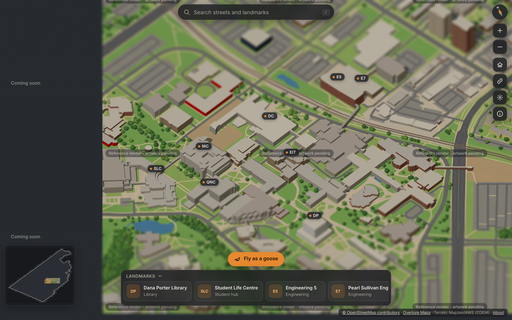

# Tiny Waterloo

An interactive, illustrated isometric map of **Waterloo, Ontario**. You can pan and zoom a miniature city, open landmark cards, search streets, and fly a Canada goose across campus. Its shadow falls on roofs and lawns, and buildings hide it as it passes behind them.

The visual approach was inspired by [TinyRJ](https://tinyrj.com/). All code, data processing and artwork here are original. The city geometry comes from OpenStreetMap (via Overture Maps) and open terrain data; see [DATA_SOURCES.md](DATA_SOURCES.md).

> **Status:** the map currently shows **procedural reference renders** of 55 tiles (University of Waterloo campus → Waterloo Park → Uptown → Laurier). Generated pixel-art tiles replace them as they arrive from the image-generation agent. See [BUILD_STATUS.md](BUILD_STATUS.md).



## Run it

```bash
npm install
npm run dev            # http://127.0.0.1:5173
```

The published map data (`web/public/data/`) is committed, so the viewer runs without the Python pipeline.

```bash
npm run build          # type-check + production build into web/dist
npm run preview        # serve the build at http://127.0.0.1:4173
```

Useful URL forms:
- `#cx,cy,zoom` restores a view. The share button copies one.
- `?perf=1` shows the performance HUD.

### Controls

| Map | Goose flight |
|---|---|
| Drag / arrows / WASD: pan · wheel, pinch, `+` `-`: zoom · `0`: home · `/`: search · `M`: minimap · `Esc`: close panels | `A` `D`: turn · `W` `S`: climb or dive · `Shift`: boost · `Space`: flap · `L` or `Esc`: land |

## How it works

```
OSM / Overture + AWS terrain ──► local metric scene ──► reference renders (headless three.js, fixed camera)
                                       │                       │ colour · packed heights · class IDs
                                       │                       ▼
                                       │              image-request packets ──(user relays)──► image agent
                                       │                       ▲                                   │
                                       │                       └──── import QA ◄── returned art ◄──┘
                                       ▼
                    collision field · search · landmarks ──► web/public/data ──► browser viewer
```

- **One fixed camera** (`config/world.json`): orthographic, heading 20°, tilted 45° down, 0.293 m per artwork pixel, sun from the south-west. The reference renderer, the height tiles, the image prompts, the goose overlay and the effects all derive from these same axes (`pipeline/world.py` ↔ `web/src/frame.ts`).
- **Artwork** is 1024 px square tiles, served at 256, 512 and 1024 px, plus a 64 px-per-tile overview. The viewer draws them on a Canvas 2D. It loads at most 6 tiles at once, nearest the centre first, cancels obsolete requests, keeps an LRU of decoded bitmaps bounded by bytes, and retries failed tiles.
- **Depth.** Each tile has a lossless 512 px height map of the visible surface (`z = (256·R + G)/100 − 100` m, valid when `B > 127`). The goose overlay uses it to reconstruct the city surface per pixel. That drives occlusion (a stippled silhouette when the goose is behind buildings) and sun shadows that land on lawns, facades and roofs. A separate top-down 2 m **collision field**, built from the source geometry, makes buildings and terrain solid and tree canopies soft.
- **Effects** (WebGL2): mask-driven tree sway (8 Hz) and water shimmer (6 Hz), plus a depth-aware tilt-shift that focuses on the surface under the cursor.
- **Artwork generation** happens outside this project. A separate image-generation agent is reached through the user. `pipeline/art_request.py` writes self-contained `IMAGE_REQUEST_<batch>.md` packets with reference attachments, and `pipeline/art_import.py` checks the returned images (alignment, geometry, style, seams) before accepting them. See [docs/ART_PIPELINE.md](docs/ART_PIPELINE.md).

## Rebuild the assets

The pipeline needs Python 3.11+ (tested on 3.13), Node 20+ and a Chromium that Playwright can drive. In the build container Playwright was preinstalled. On a Mac, run `npm i -D playwright && npx playwright install chromium`.

```bash
pip install -r requirements.txt
scripts/build_assets.sh                     # fetch -> scene -> render 55 tiles -> publish -> collision/search/landmarks -> validate
FETCH=0 scripts/build_assets.sh             # reuse data_cache/
REGIONS=campus2x2 scripts/build_assets.sh   # just the first 2x2 patch
```

Each step can also be run on its own (`pipeline/*.py`, `render/render_refs.mjs`), and each script documents its inputs and outputs at the top. A tile takes about 3 s to render with software WebGL. The whole city is 589 tiles (`web/public/data/coverage.json`).

## Image-generation workflow (batches)

1. `python3 pipeline/art_request.py status` lists batches. **B001** (the style sample, tile `0_0` with Dana Porter Library) is ready.
2. Open `IMAGE_REQUEST_B001.md`, attach the files in `art/requests/B001/` (or `art/requests/B001.zip`) to the image agent's conversation, and paste the message.
3. Bring the returned `B001_0_0.png` (and its model/settings note) back, then:
   `python3 pipeline/art_import.py B001 <folder>` for the QA report, and add `--accept` to accept and republish.
4. Accepting B001 regenerates **B002** (the other three campus tiles, using B001's art for context and continuity). Seam repairs: `python3 pipeline/art_request.py seam --pair A:B` / `--quad TL`.

## Tests

Run them one at a time: the headless software GPU is slow.

```bash
node tests/browser_check.mjs --functional --build   # end-to-end through the real UI (14 checks)
node tests/map_smoke.mjs                             # viewer (25 checks)
node tests/fx_check.mjs                              # effects (17 checks)
node tests/actor_check.mjs                           # goose alignment, collision, occlusion, shadow (16 checks)
node tests/depth_selfcheck.mjs && python3 tests/test_collision.py
python3 tests/test_art_import.py                     # image QA on synthetic returns
node tests/test_google3d_pipeline.mjs                # optional Google comparison path, offline
python3 pipeline/validate_alignment.py               # landmark roofs / junctions vs source data
```

Performance on the real device: see [docs/PERF_ON_DEVICE.md](docs/PERF_ON_DEVICE.md) (`npm run perf:device`).

## Layout

| Path | Contents |
|---|---|
| `config/` | `world.json` (camera, projection, tiles, sun, height codec), `regions.json` (staged coverage) |
| `pipeline/` | Python data pipeline, art request/import tools, validation |
| `render/` | headless three.js reference renderer (+ optional Google 3D Tiles comparison) |
| `web/` | Vite app: `src/frame.ts` map math, `src/types.ts` module contracts, `src/map/` viewer + UI, `src/fx/` effects, `src/depth/` goose, collision, feathers |
| `web/public/data/` | published tiles, heights, masks, collision, manifest, landmarks, search |
| `art/` | image requests, returned and accepted artwork, batch record |
| `docs/` | design notes, validation reports, screenshots |

## Licence notes

Map data © OpenStreetMap contributors (ODbL 1.0), via the Overture Maps Foundation. Terrain: AWS Terrain Tiles / Mapzen, including CDEM (© Natural Resources Canada, Open Government Licence – Canada). The height, class, collision and search data in `web/public/data/` are derived databases and must be shared under ODbL with attribution if distributed. No licence has been chosen yet for the project's own code and artwork.
